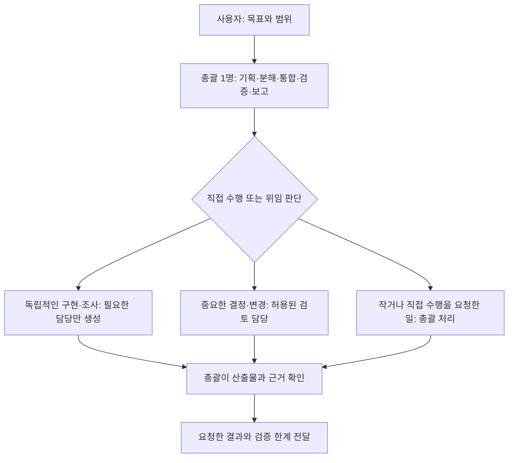

# Codex Agent Playbook

**총괄 하나가 목표와 결과를 책임지고, 필요한 작업만 실행·조사·검토 에이전트에 맡기기 위한 개인 운영 지침과 스킬 모음입니다.**

Instruction-only workflows for a single coordinator and bounded specialist agents in Codex. Korean setup documentation, reusable skills, explicit model routing, and evidence-based completion.

기획부터 구현·검증까지 맡기면서 겪은 반복 승인, 과도한 위임, 하위 모델 상속, 완료 판단의 모호함을 줄이기 위해 구성했습니다. 웹·백엔드·앱·게임·조사·글쓰기에 적용할 수 있도록 역할과 절차를 분리했습니다.

이 저장소는 개인이 구성한 실험적 워크플로입니다. 독립 실행 프로그램이나 OpenAI 공식 제품이 아니며, 파일을 복사한다고 모델·도구·권한·계정이 생기지는 않습니다.

## 운영 구조



- 팀은 상설 조직이 아닙니다. 작업 규모·의존성·공유 상태에 맞춰 필요한 역할만 사용합니다.
- 사용자가 직접 수행을 지정하면 자동 위임보다 우선합니다.
- 내부 검토는 사용자 승인, 게시·배포 권한을 대신하지 않습니다.
- 담당자의 완료 보고만 믿지 않고 실제 결과와 근거를 확인합니다.
- 병렬 수정은 파일 소유권을 나눕니다. 같은 에디터·DB·외부 서비스는 별도 조정이 필요합니다.

## 빠르게 시작하기

1. [설치와 적용](docs/setup.md)을 읽고 프로젝트 단위로 적용합니다. 기존 파일은 자동 덮어쓰지 않습니다.
2. [공통 지침 템플릿](templates/AGENTS.md)을 기존 지침과 비교·통합합니다.
3. [모델 배정과 환경 조건](docs/model-routing.md)을 확인합니다.
4. [사용 예시](examples/backend-feature.md)처럼 목표·범위·완료 기준을 전달합니다.

```text
$work-orchestrator 이 프로젝트의 로그인 오류를 조사하고,
원인에 근거한 수정과 관련 검증까지 진행해줘.
독립적으로 진행할 이점이 있을 때만 하위 에이전트를 사용하고,
작업별 산출물과 검증 근거를 확인해줘.
```

## 포함된 11개 스킬

| 역할 | 스킬 |
|---|---|
| 작업 총괄 | [work-orchestrator](skills/work-orchestrator/SKILL.md) |
| 기획·요구사항·계획 | [project-shaping](skills/project-shaping/SKILL.md) |
| 중요한 결정의 다각도 검토 | [decision-council](skills/decision-council/SKILL.md) |
| 출처 기반 조사 | [source-backed-research](skills/source-backed-research/SKILL.md) |
| 글·보고서·설명 자료 | [content-production](skills/content-production/SKILL.md) |
| 재현·원인 추적 | [systematic-debugging](skills/systematic-debugging/SKILL.md) |
| 의미 있는 동작 테스트 | [test-driven-development](skills/test-driven-development/SKILL.md) |
| 코드 검토 | [requesting-code-review](skills/requesting-code-review/SKILL.md) |
| 완료 주장 검증 | [verification-before-completion](skills/verification-before-completion/SKILL.md) |
| 필요한 작업트리 격리 | [using-git-worktrees](skills/using-git-worktrees/SKILL.md) |
| 승인된 브랜치 통합·정리 | [finishing-a-development-branch](skills/finishing-a-development-branch/SKILL.md) |

Unity·Figma·브라우저·콘텐츠 플랫폼 도구, `agent-reach` 등 선택적 연동은 포함하지 않습니다. 필요한 경우 별도로 설치하고 그 권한과 라이선스를 확인합니다.

## 모델 프로필과 검증 상태

현재 공개 템플릿은 작성자의 **총괄 GPT-6 Astra / High, 하위 GPT-6 Sol 또는 Luna** 정책을 보존합니다. 이는 사용자 환경의 설정 예시이며 모든 계정이나 제품에서 해당 이름과 호출 방식이 제공된다는 보장이 아닙니다. 지원 여부를 확인하고, 변경하려면 관련 지침을 함께 수정해야 합니다. Markdown 자체는 현재 모델을 전환하지 않습니다.

첫 공개 범위는 지침, 구조·참조 검사, 라이선스 정리입니다. 성능 향상·비용 절감·완전 자율 운영을 입증한 벤치마크는 없습니다. 예시 세 편은 사용 시나리오이며 실행 성공 사례로 제시하지 않습니다. [검증 범위와 한계](docs/limitations.md)를 확인하세요.

## 문서

- [설계 배경과 수정한 문제](docs/design-decisions.md)
- [백엔드 구현 예시](examples/backend-feature.md)
- [앱 오류 조사 예시](examples/app-bugfix.md)
- [조사에서 블로그 초안까지](examples/research-to-blog.md)
- [변경 기록](CHANGELOG.md)

## 라이선스와 출처

새로 작성한 구성·문서는 [MIT License](LICENSE)로 제공합니다. 외부 프로젝트를 수정·참고한 부분은 원저작권 고지를 보존했습니다. [THIRD_PARTY_NOTICES.md](THIRD_PARTY_NOTICES.md)에 파일별 적용 범위와 수정 내용을, [LICENSES](LICENSES)에 원문을 담았습니다. 개별 스킬 폴더에도 관련 MIT 고지를 포함했습니다.

참고 프로젝트: obra/superpowers, provencher/codex-skills, msitarzewski/agency-agents, TorpedoD/claude-council. 원저자의 공식 배포판이나 승인·보증을 의미하지 않습니다.
